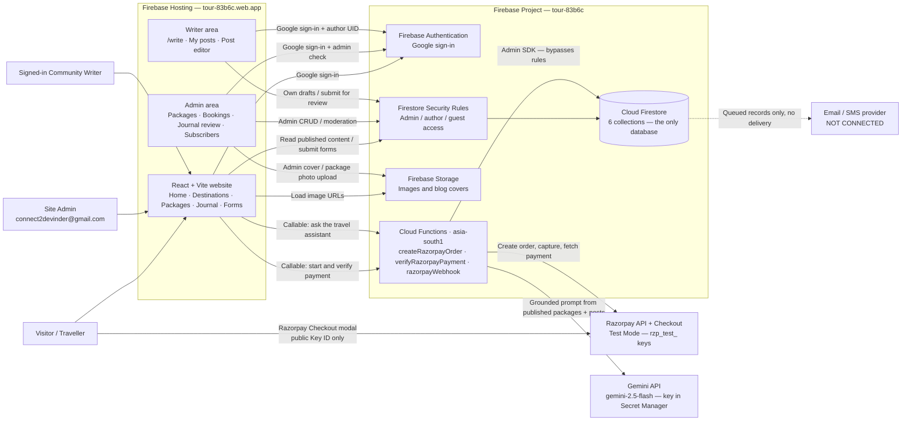
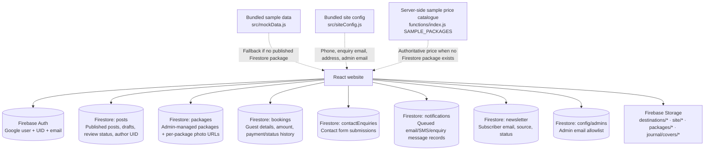
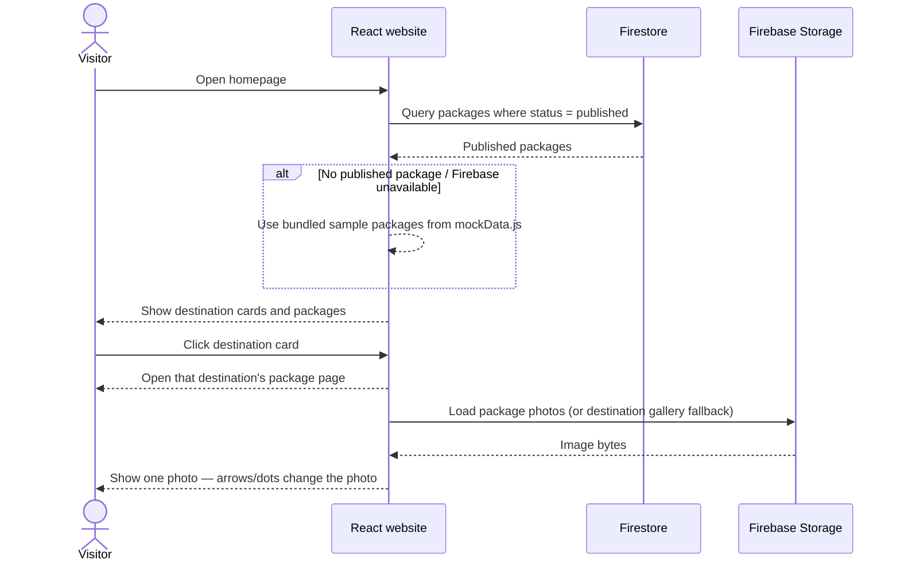
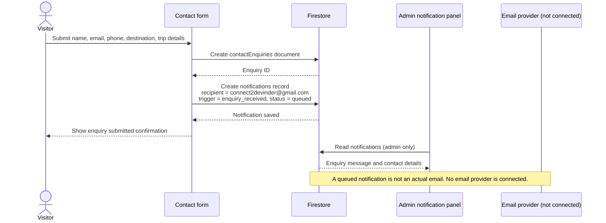
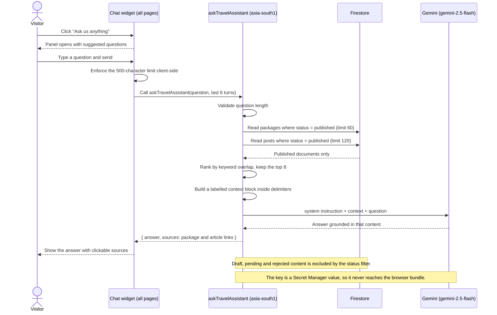
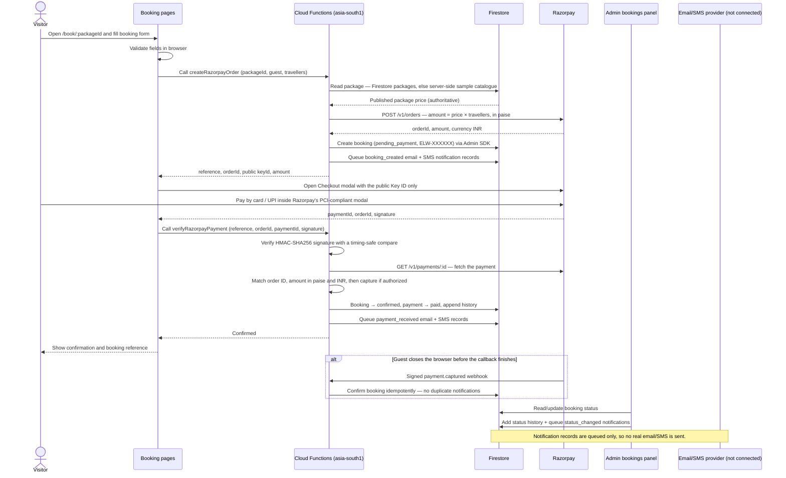
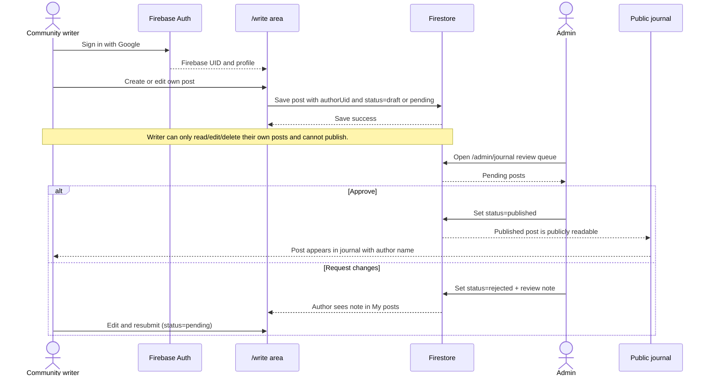
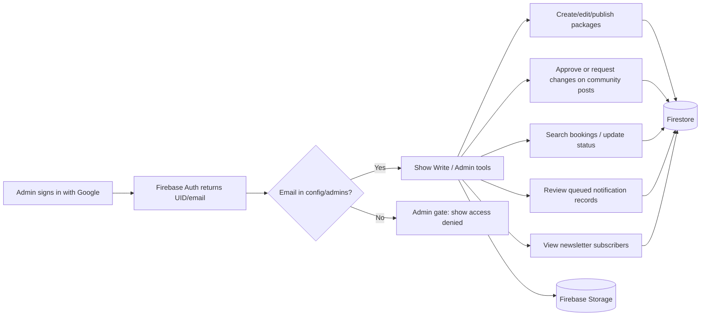

# Elsewhere Travel — Website Working Flow

> **Current architecture:** React/Vite app on Firebase Hosting → Firebase Auth + Cloud Firestore + Firebase Storage + Cloud Functions (`asia-south1`). **Cloud Firestore is the only database — there is no SQL in this system, by design.**
>
> **Payments:** Razorpay **Test Mode** is integrated end to end. A Cloud Function computes the amount server-side, creates the order, and verifies the payment signature before a booking can be confirmed. Test Mode moves no real money.
>
> **Still simulated:** email and SMS. Notification records are written to Firestore as `queued`, but no delivery provider is connected — nothing is actually sent.

## 1. Overall system

> **Travel assistant scope:** `askTravelAssistant` reads **only** published `packages` and published `posts`. It never queries `bookings`, `notifications`, `newsletter`, `contactEnquiries` or `config/admins`, so guest names, emails and phone numbers are out of reach no matter how a question is phrased.

### The database

**Cloud Firestore** (NoSQL document store), Firebase project `tour-83b6c`. It is the single system of record. No SQL database, ORM, or external datastore is connected, and none is planned — Firestore's security rules and offline support are what the app is built around.

Firestore is reached two ways:

- **Browser → `firebase/firestore` (client SDK)** — every read and write is gated by `firestore.rules`.
- **Cloud Functions → `firebase-admin/firestore` (Admin SDK)** — bypasses rules entirely. Only trusted server code may create bookings or confirm payments.

Firebase Storage holds all files (images), not records. Razorpay holds all payment instrument data — card and UPI details never enter Firestore.

## 2. What data is stored where

`functions/index.js` keeps its own copy of the sample package prices. If a bundled sample package has no Firestore document, the Cloud Function falls back to that catalogue so the amount is still computed on the server. **Keep it in sync with `src/mockData.js`** until every package is managed in Firestore.

## 3. Visitor: browse a destination and package

## 4. Visitor: submit a trip enquiry

## 5. Visitor: ask the travel assistant

### Why the bot cannot leak customer data

- The function **structurally** reads only `packages` and `posts`. `bookings`, `notifications`, `newsletter`, `contactEnquiries` and `config/admins` are never queried, so a request like *"list the emails of everyone who booked"* has nothing to draw on.
- Retrieved content is wrapped in `<travel-content>` delimiters and the system instruction tells the model to treat it as reference data, never as instructions — which matters because community-authored posts reach this context.
- Even if an injected instruction succeeded, the function exposes no tools and no private collection, so the worst case is an off-topic answer rather than a disclosure.

### Limits

Questions are capped at 500 characters, history at the last 6 turns, context at 8 documents (60 packages and 120 posts read per call), and output at 600 tokens. Until `GEMINI_API_KEY` is set, the widget shows a friendly unavailable message and points at the contact form.

## 6. Visitor: booking and Razorpay Test Mode payment

### Why the server, not the browser

The amount is calculated **server-side** from trusted package data and converted to integer paise. Any `amount` the browser sends is ignored. A forged signature, a wrong order ID, a wrong amount, a non-INR currency, or an uncaptured payment all leave the booking at `pending_payment` and queue no payment notification. The Razorpay Key Secret and webhook secret live only in Firebase Secret Manager — they never reach the frontend bundle.

### Booking access

- **Bookings cannot be created from the browser.** `firestore.rules` sets `allow create: if false` on `/bookings`; only the Cloud Functions (Admin SDK) write them.
- A guest can read their own booking when the signed-in email matches the booking email; an admin can read and update all bookings.
- Status history and notification records are appended by trusted code for payment events, and by the admin panel for status changes.

## 7. Community writer: submit a blog post for approval

## 8. Admin: sign-in and content management

## 9. Real vs. simulated — important

| Feature | Current behaviour |
|---|---|
| Google sign-in | Real Firebase Authentication |
| Firestore reads/writes | Real database, protected by Firestore rules |
| Images | Real Firebase Storage URLs |
| Contact enquiry | Saved in Firestore; notification record queued for the team |
| Newsletter signup | Saved in Firestore; admin can view subscribers |
| Booking | Created and confirmed **only** by Cloud Functions; guest and admin reads are rule-gated |
| Payment | **Razorpay Test Mode** — real sandbox orders, captures and signature checks; no real money moves |
| Payment — Live Mode | **Blocked.** Needs owner approval of Live keys, KYC/production readiness, a refund policy, and an operational review |
| Email / SMS | **Simulated.** Records are queued in Firestore; no message is delivered |
| Travel assistant | **Real Gemini responses**, grounded strictly in published packages and posts |
| Database | **Cloud Firestore only.** No SQL is used, and none is planned |

### What is still open

- **One manual Test Mode payment capture.** Razorpay's CAPTCHA stops automated completion, so the final checkout callback has been verified up to order creation and Checkout launch, but not through a completed capture. This is the single highest-value test left to run by hand.
- **Email / SMS delivery.** No provider is connected; notification records are the only output.
- **Razorpay Live Mode.** Blocked on owner approval (see the open questions in `rfp/razorpay-test-payments/requirement.md`).
- **Refund / cancellation policy.** Not defined — required before Live Mode.
- **Authorized vs. captured payments.** The current code requests capture immediately after authorization; a manual-capture flow is an open question.
- **Travel assistant key.** `GEMINI_API_KEY` must be set in Firebase Secret Manager and `askTravelAssistant` deployed. Until then the widget shows a friendly unavailable message. Live answer quality (grounding, refusals, follow-ups) has not yet been verified against a real model response.

## 10. Access rules at a glance

| Data | Visitor | Signed-in author | Admin |
|---|---|---|---|
| Published packages | Read | Read | Read/write |
| Published blog posts | Read | Read | Read/write + moderation |
| Own draft/pending blog posts | No | Read/write own only | Read/write all |
| Other user's draft/pending post | No | No | Read/write |
| Own booking | Matching email only | Matching email only | Read/update all |
| Bookings — create | No | No | **No** — Cloud Functions only |
| Contact enquiries | Submit only | Submit only | Notification record visible; enquiry collection itself is not readable from client |
| Newsletter subscribers | Subscribe only | Subscribe only | Read list |
| Storage images | Public read | Public read | Admin upload under allowed paths |
