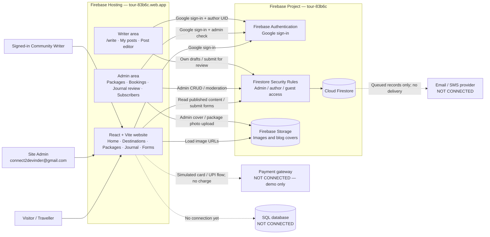
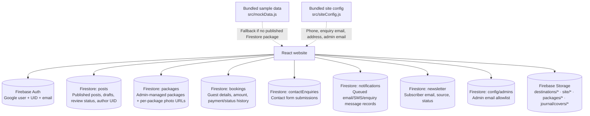
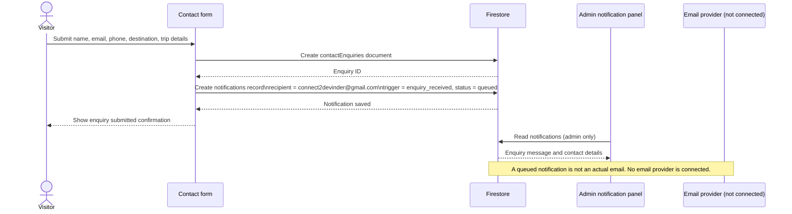
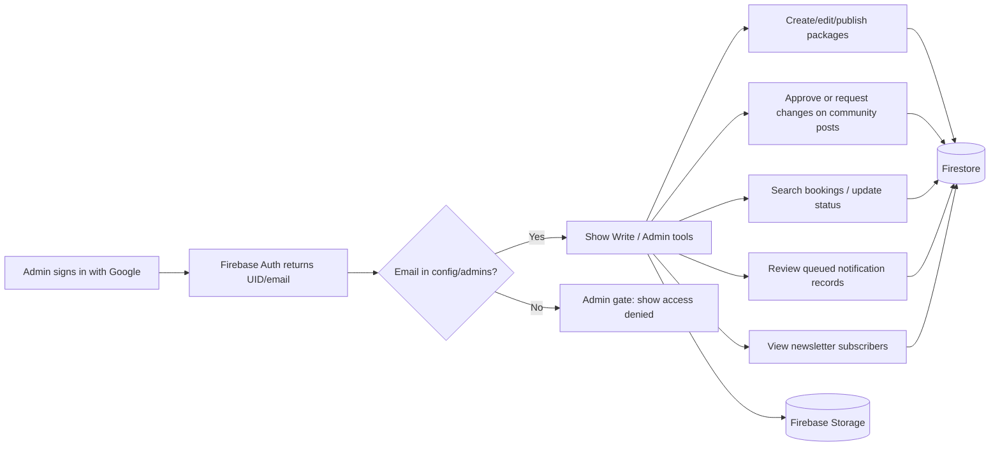

# Elsewhere Travel — Website Working Flow

> **Current architecture:** React/Vite app on Firebase Hosting → Firebase Auth + Firestore + Firebase Storage. **SQL is not connected yet.**
>
> **POC limitations:** payment is simulated in the browser; email/SMS notifications are saved as `queued` records in Firestore, but no delivery provider is connected.

## 1. Overall system



## 2. What data is stored where



## 3. Visitor: browse a destination and package

```mermaid
sequenceDiagram
    actor Visitor
    participant Site as React website
    participant DB as Firestore
    participant Storage as Firebase Storage

    Visitor->>Site: Open homepage
    Site->>DB: Query packages where status = published
    DB-->>Site: Published packages
    alt No published package / Firebase unavailable
        Site-->>Site: Use bundled sample packages from mockData.js
    end
    Site-->>Visitor: Show destination cards and packages
    Visitor->>Site: Click destination card
    Site-->>Visitor: Open that destination's package page
    Site->>Storage: Load package photos (or destination gallery fallback)
    Storage-->>Site: Image bytes
    Site-->>Visitor: Show one photo; arrows/dots change the photo
```

## 4. Visitor: submit a trip enquiry



## 5. Visitor: booking and demo payment

```mermaid
sequenceDiagram
    actor Visitor
    participant Site as Booking pages
    participant DB as Firestore
    participant Admin as Admin bookings panel
    participant Gateway as Payment gateway (not connected)
    participant Notify as Email/SMS provider (not connected)

    Visitor->>Site: Open /book/:packageId and fill booking form
    Site->>Site: Validate fields; calculate price × travellers in browser
    Site->>DB: Create booking (pending_payment) + initial history
    Site->>DB: Queue booking_created email + SMS notification records
    DB-->>Site: Booking reference ELW-XXXXXX
    Visitor->>Site: Complete demo card/UPI payment
    Site->>Site: Simulate payment result (no money moves)
    Site->>DB: Mark booking confirmed + payment paid + add history
    Site->>DB: Queue payment_received email + SMS records
    Site-->>Visitor: Show confirmation and booking reference
    Admin->>DB: Read/update booking status
    Admin->>DB: Add status history + queue status_changed notifications
    DB-->>Admin: Booking and notification records
    Note over Site,Gateway: No real gateway, server-side payment verification, refund, or charge exists yet.
    Note over DB,Notify: Notification records are queued only; no real email/SMS is sent.
```

### Booking access

- Guest bookings can be read by the matching signed-in email or by an admin.
- Admin can search/filter bookings and update their status.
- Payment amount is currently computed client-side; production needs server-side calculation and gateway verification.

## 6. Community writer: submit a blog post for approval

```mermaid
sequenceDiagram
    actor Writer as Community writer
    participant Auth as Firebase Auth
    participant Site as /write area
    participant DB as Firestore
    actor Admin
    participant Journal as Public journal

    Writer->>Auth: Sign in with Google
    Auth-->>Site: Firebase UID and profile
    Writer->>Site: Create or edit own post
    Site->>DB: Save post with authorUid and status=draft or pending
    DB-->>Site: Save success
    Note over Writer,DB: Writer can only read/edit/delete their own posts; writer cannot publish.
    Admin->>DB: Open /admin/journal review queue
    DB-->>Admin: Pending posts
    alt Approve
        Admin->>DB: Set status=published
        DB-->>Journal: Published post is publicly readable
        Journal-->>Writer: Post appears in journal with author name
    else Request changes
        Admin->>DB: Set status=rejected + review note
        DB-->>Site: Author sees note in My posts
        Writer->>Site: Edit and resubmit (status=pending)
    end
```

## 7. Admin: sign-in and content management



## 8. Real vs. simulated — important

| Feature | Current behaviour |
|---|---|
| Google sign-in | Real Firebase Authentication |
| Firestore reads/writes | Real database, protected by Firestore rules |
| Images | Real Firebase Storage URLs |
| Contact enquiry | Saved in Firestore; notification record queued for the team |
| Newsletter signup | Saved in Firestore; admin can view subscribers |
| Booking | Saved in Firestore; guest/admin access rules apply |
| Payment | **Simulated**; no card/UPI charge or payment gateway |
| Email / SMS | **Simulated**; records are queued in Firestore, no message delivered |
| SQL | **Not connected**; current system of record is Firestore |

## 9. Access rules at a glance

| Data | Visitor | Signed-in author | Admin |
|---|---|---|---|
| Published packages | Read | Read | Read/write |
| Published blog posts | Read | Read | Read/write + moderation |
| Own draft/pending blog posts | No | Read/write own only | Read/write all |
| Other user's draft/pending post | No | No | Read/write |
| Own booking | Matching email only | Matching email only | Read/update all |
| Contact enquiries | Submit only | Submit only | Notification record visible; enquiry collection itself is not readable from client |
| Newsletter subscribers | Subscribe only | Subscribe only | Read list |
| Storage images | Public read | Public read | Admin upload under allowed paths |
